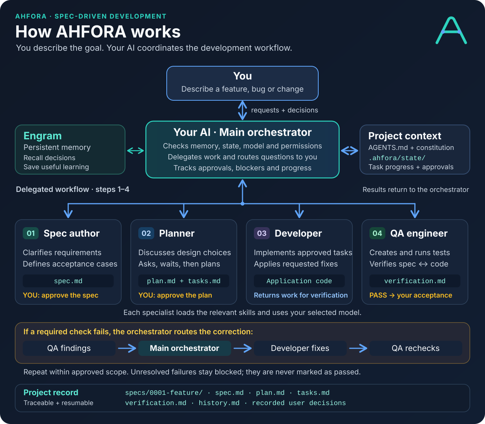

<p align="center">
  
</p>

<p align="center"><strong>Give your AI a development process it can resume, explain, and verify.</strong></p>

# AHFORA

**Agnostic Harness for Agents** is a portable AI-agent framework/harness built on
**Spec-Driven Development (SDD)**. In SDD, you clarify and approve a specification
before implementation; that specification guides the plan, code and verification.
A small npm CLI installs instructions, specialist
roles, skills, templates, and local project state conventions into your repository.
Your coding agent then follows the process with you.

**Specify → approve → plan → approve → implement ↔ verify → accept.**

AHFORA is model- and application-stack-agnostic. It deliberately requires
[Engram](https://github.com/Gentleman-Programming/engram) for persistent memory.
It supports native adapters for Claude Code, OpenCode and Gemini CLI, plus a generic
sequential-role mode for other capable coding agents.

## Quick start: install, open, describe

With **Node.js 22 or later**, start from your project's root directory:

1. **Install AHFORA** with the supported native adapters:

   ```sh
   npx ahfora@latest init . --clients all
   ```

2. **Open or restart your AI client** in that directory: Claude Code, OpenCode or
   Gemini CLI.
3. **Describe what you want to build**, for example:

   > Build a task manager with projects, due dates and reminders.

**AHFORA starts automatically from that request.** The agent checks Engram access,
asks for missing project decisions and guides you through the SDD workflow. You
approve the specification, the plan and the verified result as you go.

See [installation options](#install-into-a-project) or the
[full conversational workflow](#start-working-with-your-ai) for more detail.

## How it works



The **main agent orchestrates every handoff**. Specialists own their assigned work;
Engram supplies persistent memory, while project files retain the current requirements,
decisions and progress. You approve the spec, the plan and the verified result.

[Open the full-size diagram](assets/ahfora-workflow.svg).

## Why AHFORA?

- **Specifications that can be tested:** user stories, EARS requirements, measurable
  non-functional constraints, and success/failure acceptance scenarios.
- **Defined responsibilities:** a spec author, planner, developer, and QA engineer
  coordinated by the user's main agent.
- **Traceable change:** requirements connect to tasks, implementation and evidence.
  Fixes and evolutions get linked specs; completed contracts retain an appended history.
- **Recoverable work:** shared lifecycle records, authoritative task progress,
  local checkpoints and Engram context.
- **Proportionate architecture:** discuss and record the right architecture once;
  apply SOLID without forcing a framework or unnecessary layers.
- **User-controlled improvement:** agents may propose better local rules, but must
  explain the change and obtain approval before applying it.
- **Portable installation:** Node.js, no runtime dependencies, no compilation step,
  and no application source or package.json injected into the destination.

AHFORA makes the workflow explicit and reviewable. Markdown instructions are not a
permission sandbox or a proof of semantic correctness; actual tests, review and user
decisions are still required. The CLI scaffolds the framework; it does not run models.

## Requirements

- **Node.js 22 or later** and npm/npx for installation.
- **Linux or Windows** as initial platform targets.
- A coding agent with project file access and suitable execution capabilities.
- Working **Engram access in the active AI session** before starting the SDD workflow.

The generator can install the instructions before Engram is connected. At first use,
the orchestrator checks a real memory operation. If Engram is missing or inaccessible,
it asks permission to install/configure it, then waits. There is no silent global
installation, automatic provider setup, or model API key requirement in the CLI.

## Install into a project

```sh
# Existing repository, with all three native adapters
npx ahfora@latest init . --clients all

# New directory, OpenCode adapter
npx ahfora@latest init my-project --clients opencode

# Selected adapters
npx ahfora@latest init . --clients claude,gemini

# Generic instructions and skills only (also the default)
npx ahfora@latest init .

# Inspect the operation without changing files
npx ahfora@latest init . --clients all --dry-run
```

With no arguments, `npx ahfora@latest` initializes the current directory in generic
mode. Quote paths containing spaces. These commands work in Linux shells and Windows
PowerShell. For reproducible installations, replace `@latest` with an exact release.

### Choose your mode

- **Generic (default):** installs the shared instructions, roles, skills and templates
  for clients that automatically load `AGENTS.md`, without native subagent registration.
  The agent can perform the roles sequentially; separate contexts are not required.
- **Native adapters:** select `claude`, `opencode`, `gemini`, or `all` to also register
  specialist subagents in those clients' own directories. The main agent delegates
  work to them while following the same canonical rules.

The responsible native subagent must do its assigned work when available. If it
cannot run or lacks a required capability, the orchestrator explains the specific
problem and offers a viable alternative before continuing in another mode. Sequential
execution or saving a specialist's text on its behalf requires an explicit, scoped
decision; a previously approved fallback can be reused with a visible explanation.

For Claude Code, OpenCode or Gemini CLI, select the matching adapter. Both modes
require Engram and follow the same specification, approval and verification process.

## Start working with your AI

Open your AI client inside the project and describe what you want to develop:

> Build a task manager with projects, due dates and reminders.

**No activation prompt is needed.** The client loads the project's instructions and
the agent starts AHFORA's readiness checks and SDD workflow automatically. OpenCode
loads `AGENTS.md`; the Claude and Gemini adapters import it from their native context
files. If the client was already open during installation, restart it once to load
the new instructions. See [client integration](docs/clients.md).

The agent checks Engram, recovers existing work and chooses the appropriate role.
Every subagent uses your selected model; if that choice is unknown, the agent asks
before invoking it. For a new project, it also asks about missing settings such as
architecture, approved commands and the planner's `high-reasoning` profile. On first
use, it also asks **where your application's source code should live**: a folder
you name, the project root, or multiple paths for different applications/packages.
It explains relevant language/toolchain conventions and waits for your choice before
assigning application paths or generating code. For existing projects, it asks
whether to retain the detected layout. The approved paths are recorded in
`docs/constitution.md` and reused in later sessions and role handoffs.

Those are project decisions, not an activation procedure. Existing confirmed settings
are reused. Spec, plan and final acceptance still require your approval.

Then work conversationally:

1. **Request:** “Add password recovery.” The agent clarifies requirements and drafts a spec.
2. **Review:** read the resulting `spec.md`, answer questions, and explicitly approve it.
3. **Plan:** the planner compares approaches and prepares `plan.md` and `tasks.md`.
   It asks blocking decisions immediately and waits; independent confirmations can
   be grouped at the end of the draft. Your answers determine the design.
   Confirm the E2E decision and approve the design/task definitions.
4. **Implement and verify:** developer and QA work within that scope. QA reports
   evidence and requests developer corrections through the orchestrator; each result
   goes back to QA until required checks pass or an explicit blocker needs your decision.
5. **Accept:** review the integrated result and verification report, then accept it.
6. **Resume:** “Continue the pending work.” The agent recovers the relevant state.
7. **Maintain:** “Fix this password recovery bug.” The agent locates the affected spec
   and prepares the linked fix.

The default correction budget is three rounds for the same underlying failure.
Unresolved failures then require your decision. There are no mandatory slash commands.

## What gets generated?

```text
your-project/
├── AGENTS.md                         # Orchestration + owner-editable instructions
├── docs/constitution.md              # Source layout, architecture, commands, decisions
├── specs/README.md
├── .agents/skills/                   # Seven canonical portable skills
└── .ahfora/
    ├── manifest.json                # Installed version and requested adapters
    ├── project.json                 # Model/test preferences; no credentials
    ├── models.md                    # User-selected model gate for every subagent
    ├── workflow.md                  # Explicit lifecycle and approval gates
    ├── spec-identity.md             # Short spec numbers and coordinated reservation
    ├── engram.md                    # Memory readiness and recovery protocol
    ├── agents/                      # Four canonical role contracts
    ├── templates/                   # Specs, plans, tasks, evidence, history, state
    ├── state/                       # ID ledger, shared progress/approvals; local/ is ignored
    ├── improvements/                # Proposed, authorized and verified local changes
    ├── references.md
    └── LICENSE                      # Framework's MIT license; not your app's license
```

Selected adapters add `.claude/agents/`, `.opencode/agents/`, or `.gemini/agents/`.
Claude also gets thin skill bridges and `CLAUDE.md`; Gemini gets `GEMINI.md`.
The main instruction entry points direct the client to the canonical `AGENTS.md`.
Native adapters enable file editing for their roles. Gemini also receives a project
`settings.json` with `auto_edit`; existing settings are preserved. Each role must
still stay within its assigned artifacts and the approved scope.

Agents create each spec progressively:

```text
specs/0001-task-manager/
├── spec.md
├── plan.md
├── tasks.md
├── verification.md
└── history.md                       # Added/appended when completed work evolves
```

Spec IDs are short, sequential four-digit strings: **0001, 0002, 0003…**. The
orchestrator reserves each number in `.ahfora/state/spec-ids.json`. Issued numbers
are never reused; teams coordinate reservations before parallel branch work.

Before asking requirements questions, the agent identifies what it is preparing:

> I'm preparing **SPEC 0001 — Task manager**.
> Destination: `specs/0001-task-manager/spec.md`.
> Phase: requirements clarification.

The same ID/title remains visible in question batches, handoffs and review requests.
The conversation uses your language; spec documents remain in English.

## Roles and skills

| Role | Responsibility |
| --- | --- |
| Main agent / orchestrator | Bootstrap, clarify, delegate, manage gates/state and user decisions |
| `ahfora-spec-author` | Write a complete, unambiguous, verifiable spec |
| `ahfora-planner` | Design the approved spec and create its plan/tasks |
| `ahfora-developer` | Implement assigned, approved tasks |
| `ahfora-qa-engineer` | Create meaningful tests, verify requirements, report evidence |

Canonical skills: `ahfora-sdd`, `ahfora-requirements`, `ahfora-architecture`,
`ahfora-solid`, `ahfora-verification`, `ahfora-maintenance`, `ahfora-improvement`.
They use the [Agent Skills format](https://agentskills.io/specification). The shared
`.agents/skills/` discovery convention and native subagent registration are distinct.
See the [compatibility details](docs/clients.md).

## Existing projects and repeated installation

- Existing user instructions are preserved; a clearly delimited AHFORA entry block
  is appended to shared instruction files when absent.
- Different existing constitution, role, skill and template files are **preserved**
  and listed for review. Local improvements are not overwritten on reinstall.
- Same-version reinstall is idempotent. You can add adapters by rerunning with
  `--clients`; previous adapter choices are retained in the manifest.
- Local session checkpoints and the temporary installer lock are added to `.gitignore`.
  Specs, shared state and approvals remain versionable.
- Conflicting file types, malformed markers and symbolic links at generated paths
  stop installation during preflight. Concurrent installers coordinate with a lock.
- Different manifest versions are rejected for manual migration review. See
  [maintenance and upgrades](docs/maintenance.md).

For a codebase without specs, the agent first investigates actual behavior and asks
you which behavior should become the baseline. It does not canonize existing bugs.

## Documentation

- [Client integration and model routing](docs/clients.md)
- [State, maintenance and upgrades](docs/maintenance.md)
- [Adding project roles and skills](docs/extending.md)
- [Behavioral evaluation](docs/behavioral-evaluation.md)
- [Brand assets](docs/brand.md)
- [Changelog](CHANGELOG.md)

## License and author

Created by **Deiver** — [IngDeiver](https://github.com/IngDeiver).
Distributed under the [MIT license](LICENSE). Framework artifacts carry their own
license; installing them does not change the license of your application.
