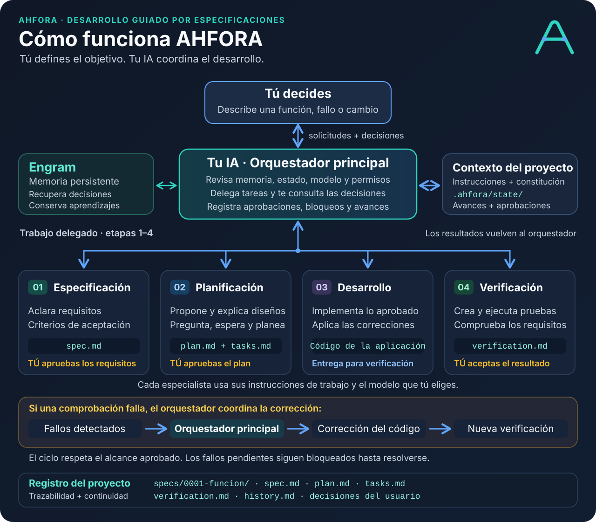

# Texto para LinkedIn

¿Tu proyecto con IA avanza rápido al principio, pero cada cambio se vuelve más difícil cuando crece?

Los agentes pierden contexto, pasan por alto reglas de negocio y aparecen errores en funcionalidades que ya estaban resueltas.

A mí también me pasó. Y me hice una pregunta: ¿cómo aprovechar la velocidad de la IA sin perder el control ni dejar atrás la ingeniería de software?

De esa búsqueda nació AHFORA: mi framework ligero y de código abierto para trabajar con agentes de IA, basado en desarrollo guiado por especificaciones (SDD).

Combina dos ideas:

🧭 Harness engineering: organizar las instrucciones, el contexto, las herramientas y los puntos de control que guían a los agentes.

📋 SDD: definir qué debe hacer el software y cómo comprobarlo antes de implementar.

El objetivo es conservar lo que sigue siendo esencial: análisis, planificación, diseño, implementación y pruebas. Con la velocidad de la IA y decisiones humanas explícitas.

¿Cómo funciona?

Tu agente principal coordina cuatro responsabilidades:

1. Especificación: aclara requisitos y criterios de aceptación.
2. Planificación: propone el diseño y las tareas, y te consulta las decisiones.
3. Desarrollo: implementa el trabajo aprobado.
4. Verificación: prueba el resultado y solicita correcciones cuando encuentra fallos.

Tú apruebas la especificación, el plan y la aceptación final. Engram y los archivos del proyecto conservan decisiones y avances para retomar el trabajo con contexto.

La calidad se construye con requisitos claros, revisión y evidencia. AHFORA ayuda a mantener ese proceso visible y trazable mientras desarrollas con IA.

🚀 Para probarlo, necesitas Node.js 22 o superior. En la carpeta de tu proyecto ejecuta:

```sh
npx ahfora@latest init . --clients all
```

Después abre Claude Code, OpenCode o Gemini CLI y escribe:

«Crea un gestor de tareas con proyectos, fechas de entrega y recordatorios».

AHFORA se activa desde esa petición, comprueba el acceso a Engram y te guía por el proceso. Si falta configurar Engram, te pide autorización antes de hacerlo.

Escribir código más rápido tiene mucho más valor cuando podemos entenderlo, verificarlo y mantenerlo.

🔗 Código y documentación: https://github.com/IngDeiver/ahfora
📦 npm: https://www.npmjs.com/package/ahfora

¿Qué te cuesta más al desarrollar con IA: conservar el contexto, mantener las reglas de negocio o evitar regresiones?

#InteligenciaArtificial #IngenieriaDeSoftware #SDD #HarnessEngineering #CodigoAbierto

## Diagrama para adjuntar


